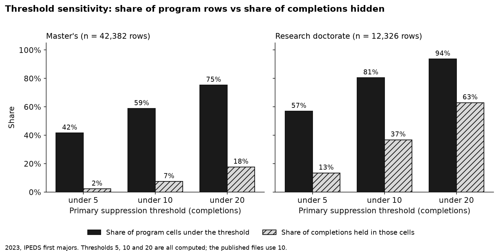

# Graduate program data under a disclosure rule: what survives?

Public IPEDS data lists master's and doctoral completions for almost every U.S. institution, program by program. But a large share of those program-level rows are small: a handful of graduates, or none. Anyone who publishes program-level counts, or builds a dashboard on them, has to decide what to do with those rows.

This project asks: **if a standard small-cell disclosure rule is applied (hide any program row with fewer than 10 completions), how much of the graduate-degree picture survives, and what can a reader still trust?**

All data are public, aggregate, institution-level counts from NCES IPEDS and NSF NCSES. There are no student records.

## What the numbers show

All figures are for FY2023 (academic year 2022-23) unless stated, first majors only, from `outputs/key_numbers.json` and `tableau_ready/`.


**Most program rows are small.** Of 42,382 master's program rows (institution x 6-digit CIP program x award level), 58.8% have fewer than 10 completions. For research doctorates, 80.5% of 12,326 rows do.

**Those rows hold a minority of completions.** The rows under 10 hold 7.5% of master's completions, 36.8% of research-doctorate completions and 9.0% of completions at all levels combined (57,182 rows). So national and field totals are largely intact under the rule, while program-level views are sparse. Research doctorates are the exception: more than a third of their completions sit in rows that would be hidden.

**The threshold matters.** The share of rows under the threshold is computed at 5, 10 and 20 in `tableau_ready/suppression_impact.csv`:



**Hiding small cells is not enough on its own.** If exactly one cell in a group is hidden, it could be recovered by subtraction from a published total. The rule therefore also hides a neighbouring cell (complementary suppression, two passes, described in `METHODS.md`). At the threshold of 10 in 2023 this hides 2,416 extra cells across all levels (2,267 + 149), and 1,876 for master's alone. Those extra cells are 10 or more completions; they are hidden only to protect a neighbour. Including them, 38,303 of 57,182 rows (67.0%) are hidden in 2023.

**Zero-count rows.** Rows reported with a count of 0 are kept and treated as below the threshold: 11,348 of the 57,182 rows in 2023, including 8,556 master's rows. If zero-count rows are excluded, the master's share under 10 is 48.4% instead of 58.8%. The share of completions held in small rows is not affected by zeros.

**National picture, 2023.** 1,155,492 master's and doctoral completions at 2,057 institutions: 947,728 master's, 82,438 research doctorates, 122,895 professional doctorates and 2,431 other doctorates.


Total completions grew 10.3% from 2020 (1,047,606) to 2023, and 4.97% from 2022. Master's completions rose 5.98% in 2022-23 (894,277 to 947,728); the cause of that jump was not determined (see `METHODS.md`, section 7).

**A ratio, not a rate.** Dividing 2023 completions by fall 2023 graduate enrollment gives a national ratio of 0.353 (1,155,191 / 3,274,596, matched institutions). This is a ratio of two annual counts, not a completion rate, graduation rate or retention measure.

**Time to degree comes from a different source.** IPEDS has no graduate cohorts, so it cannot give time to degree or attrition for master's or doctoral programs. The only time-to-degree figures here are national medians from NSF's Survey of Earned Doctorates, Table 1-12 (research doctorates, all fields): median years from starting graduate school 7.3 and from starting the doctoral program 5.7 (2024, table nsf25349); 7.0 and 5.8 (2025, table nsf26326). They are not linked to any institution or program.

## What a reader can do with this

All of this is descriptive. Nothing here says why a number changed.

- **Program director.** Check whether your program's row would be shown or hidden at 10, and compare your own records to the national count for your CIP family. If the row is hidden in the public data, a peer comparison from IPEDS is not possible for that year, and internal records are the only option.
- **Dean.** Use field-level and institution-level totals, which survive the rule, and treat the sum of displayed program rows as a floor, since hidden rows are left out. Each percentage change in the dashboard is shown next to the number of program rows behind it.
- **Graduate dean.** Compare the completions-to-enrollment ratio with peer groups only as a ratio. It mixes different students (enrollment includes certificate students and part-timers) and different program lengths. For completion or time to degree, use your own cohort records.
- **Anyone publishing program-level data.** At every level the share of rows hidden is much larger than the share of completions hidden, though the gap is smallest for research doctorates. Report both numbers when you describe what a suppression rule costs, and consider whether a threshold of 5 or 10 matches the purpose.

## What is built and what is not

Built:

- A self-contained HTML dashboard (`dashboard/graduate_outcomes_dashboard.html`, also served from `docs/index.html`) with four views.
- Flat, suppressed CSVs in `tableau_ready/` with a data dictionary: `tableau_ready/README_data_dictionary.md`.
- A build specification (`tableau_ready/public/TABLEAU_BUILD_SPEC.md`) and upload-ready CSVs for Tableau Public in `tableau_ready/public/`. These are inputs for building a workbook; no workbook has been built.
- A reconciliation of the totals against the raw files and against NCES Digest Table 318.10 (`outputs/reconciliation.md`).

Not built:

- **No Tableau workbook has been built or published.** "tableau_ready" only means the CSVs are flat, snake_case and UTF-8.
- No cohort completion rate, attrition or time to degree from IPEDS (it does not exist for graduate students).
- No causal analysis and no claim about any single institution. Institution examples are illustrations read from public data.
- Suppression here is standard disclosure-avoidance practice for small cells. It is not a FERPA compliance claim or a disclosure review.

## Dashboard

Open `dashboard/graduate_outcomes_dashboard.html` in a browser; it works offline (plotly.js and all data are embedded, so the file is about 8 MB). The four views read the same suppressed data. They are filtered views, not access control.

1. **Program director.** Pick an institution, award level and CIP family. Shows family totals by year (displayed cells only, with the count of hidden cells), a single-program chart and the full program matrix with hidden cells marked.
2. **Dean.** Field mix of displayed completions, year-over-year change and change vs 2020 for the institution total (with program-row counts behind each percentage), and the ratio over time.
3. **Graduate dean.** The completions-to-enrollment ratio against peers (control, Carnegie class, state, national), the ratio over time against the peer median, and the share of the institution's program rows that are hidden against peers.
4. **Provost.** Totals by level 2020-2023, the suppression share at thresholds 5, 10 and 20, the national ratio, the largest fields, and the NSF SED medians (labelled as a separate, national, field-level source).

Small-n warnings appear when a percentage rests on fewer than 5 program rows or 30 completions, or a peer group has fewer than 10 institutions.

### Publishing the dashboard with GitHub Pages

`src/04_build_dashboard.py` also writes the same file to `docs/index.html`. In the repository settings, choose Pages, then deploy from branch `main`, folder `/docs`. The dashboard is then served at `https://pranavmalhotra05-dev.github.io/ipeds-graduate-outcomes/` once Pages is enabled. The file is about 8 MB, well under GitHub's limits, but it loads slowly on a weak connection.

## Repository layout

| path | contents |
|---|---|
| `src/` | `01_ingest.py` (download and load into DuckDB), `02_build_measures.py` (measures, suppression, CSVs), `03_reconcile.py` (reconciliation), `04_build_dashboard.py` (HTML dashboard), `05_build_tableau_public.py` (Tableau Public inputs), `06_make_charts.py` (README charts), `run_all.py` |
| `sql/` | SQL used by step 02: base, suppression, measures, suppression impact, display |
| `data_raw/` | downloaded zips and workbooks (not committed; recreated by step 01) |
| `data/` | `ipeds.duckdb`, rebuilt on every run (not committed) |
| `outputs/` | `ingest_log.md`, `measure_definitions.md`, `measures_log.md`, `reconciliation.md`, `reconciliation.json`, `key_numbers.json` |
| `tableau_ready/` | publishable CSVs and `README_data_dictionary.md` |
| `dashboard/` | dashboard template, build notes and the built HTML |
| `docs/` | `index.html` (GitHub Pages copy of the dashboard) and `img/` (README charts) |
| `METHODS.md` | sources, definitions, suppression rules, reconciliation, limits |
| `SUMMARY_BRIEFS.md` | four one-page briefs, one per dashboard view |

## Reproduce

```
git clone https://github.com/pranavmalhotra05-dev/ipeds-graduate-outcomes.git
cd ipeds-graduate-outcomes
pip install -r requirements.txt
python src/run_all.py
```

Step 01 downloads about 64 MB of source files from nces.ed.gov and ncses.nsf.gov (they are reused if already in `data_raw/`); the whole run takes a few minutes. `run_all.py` stops at the first step that fails. Tested with Python 3.13.

## Data sources

| source | years | URL |
|---|---|---|
| IPEDS Completions (C{year}_A), final/revised files | 2019-20 to 2022-23 (file years 2020-2023) | https://nces.ed.gov/ipeds/datacenter/data/C2023_A.zip (same pattern for other years) |
| IPEDS Completions 2023-24 (provisional, loaded but not used in any output) | 2023-24 | https://nces.ed.gov/ipeds/datacenter/data/C2024_A.zip |
| IPEDS Fall Enrollment (EF{year}A) | fall 2020 to fall 2023 (2023 provisional) | https://nces.ed.gov/ipeds/datacenter/data/EF2023A.zip |
| IPEDS Institutional Characteristics (HD{year}) | 2020-2024 | https://nces.ed.gov/ipeds/datacenter/data/HD2023.zip |
| CIP 2020 titles | CIP 2020 | https://nces.ed.gov/ipeds/cipcode/Files/CIPCode2020.csv |
| NSF NCSES Survey of Earned Doctorates, Table 1-12 | 1974-2025 | https://ncses.nsf.gov/pubs/nsf26326/assets/data-tables/tables/nsf26326-tab001-012.xlsx and https://ncses.nsf.gov/pubs/nsf25349/assets/data-tables/tables/nsf25349-tab001-012.xlsx |
| NCES Digest of Education Statistics 2023, Table 318.10 (reconciliation only) | 2019-20 to 2022-23 | https://nces.ed.gov/programs/digest/d23/tables/dt23_318.10.asp |

## Limits

- IPEDS completions are institution-level aggregates of awards, not students. A person with two degrees counts twice.
- IPEDS Graduation Rates cover undergraduate cohorts only, so there is no graduate completion rate, attrition or time to degree from IPEDS. NSF SED medians are the only time-to-degree figures, and they are national, field-level and research-doctorate only.
- The ratio of completions to enrollment is not a rate (see above). Enrollment has no program or award-level detail in this file, so the ratio exists only at institution and national level.
- The suppression rule is a simple two-pass rule, not an optimal algorithm, and it does not guarantee against disclosure. Some groups have two hidden cells with a published combined total (`METHODS.md`, section 4).
- Fall 2023 enrollment and 2023-24 completions are provisional. The 2023 master's jump is unexplained, and the 2023 IPEDS master's total is 7.5% above the NCES Digest figure, which is itself labelled projected.
- The mapping from CIP families to SED broad fields is approximate and was made by the author.
- Institutions that merge, close or change UNITID appear as separate series.

## Compared with other public IPEDS projects

Many public IPEDS projects focus on undergraduate enrollment, admissions or graduation rates and use institution-level totals. This one is limited to graduate completions at program grain, applies and documents a small-cell rule with sensitivity at three thresholds, labels ratios as ratios, and reconciles its totals against the raw files and published figures.

## License and data notice

The code and documentation in this repository are released under the MIT License (see `LICENSE`), copyright 2026 Pranav Malhotra.

**Notice on data.** The IPEDS data come from the National Center for Education Statistics (NCES), U.S. Department of Education, and the Survey of Earned Doctorates tables come from the National Center for Science and Engineering Statistics (NCSES), National Science Foundation. Both are U.S. government works in the public domain. The MIT License covers the code, not the source data. Please cite the original sources (the URLs above) when you reuse the data. The CSVs in `tableau_ready/` are derived from those sources with the suppression described in `METHODS.md`.
